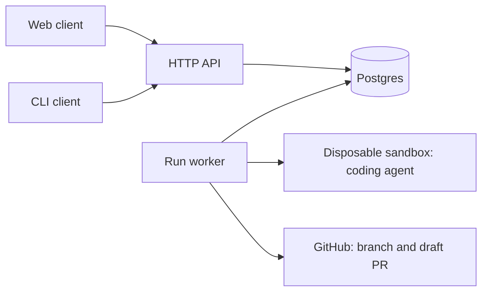

# Prompt-to-PR MVP

## Decision

Build one small application around one durable resource: a **run**.

A run accepts a repository and a prompt, executes one coding session, and ends with a draft pull request, an explicit no-change result, or a useful failure. It never waits for review or merge. Both the web app and CLI use the same HTTP API.

Start fresh in `prompt-to-pr/` within `cmraible/herbie`, with a separate private database schema. Use Herbie as a source of proven behavior and regression cases, not as the starting application to trim down. Existing Herbie stays operational; historical migration is outside this MVP.

Assumptions: small private beta, service-funded model access, GitHub repositories where the user has push access, default branch only, one fixed model and sandbox size. Start with one active run globally; queued runs wait. No organizations/teams inside the product, billing, fork-based contributions, or per-repository environment configuration.

## What to carry forward

Herbie's [service contract](service-contract.md) already establishes useful behavior: authenticated web and CLI clients, durable queued work, repository authorization, disposable execution, and trusted publication with write credentials outside the agent.

Its [workflow experiments](../research_notes/Workflow%20evaluation/shared/FINDINGS.md) show why blind retries are dangerous: a lost launch response can duplicate paid execution, and a lost publication response can duplicate PRs. A workflow engine alone does not remove these problems.

Keep those lessons. Drop the project lifecycle, recurring work, separate feedback/repair machinery, model/resource selectors, provider switching, live WebSockets, and deployment portability work.

Apply [grugbrain's principles](https://grugbrain.dev/): build a working vertical slice early, keep interfaces small, defer speculative abstractions, and emphasize integration tests.

## User flow

1. Sign in with GitHub using the same approach as Herbie.
2. List repositories accessible to both the user and the GitHub App, filtering to repositories where the user can push. Follow GitHub pagination.
3. If access is missing, offer “Connect repositories” through GitHub App installation. Login proves identity; installation grants repository access. Verify installation callbacks against the signed-in user.
4. Choose a repository, enter a prompt, and submit.
5. Immediately show the persisted run, its current stage, and a small activity history. Closing the browser has no effect on execution.
6. Show “Open draft PR,” “No changes needed” with a reason, or a failure with its stage and an actionable explanation.

Web has a new-run form, run list, and run detail page. Poll active runs every few seconds; stop polling terminal runs. No terminal emulator or interactive agent conversation.

CLI supports `login`, `logout`, `repos`, `run --repo owner/name --prompt '...'`, `runs`, and `run status <id>`. Submission returns immediately; optional `--wait` polls the same endpoints. Include `--json` for scripts. Authenticate through browser approval and a device code, using the existing first-party session-token approach; protect stored tokens and never ask for a GitHub PAT. [Better Auth supports device authorization for application sessions](https://better-auth.com/docs/plugins/device-authorization).

## Architecture

Use TypeScript, the existing React/Vite approach, Better Auth, Postgres, and a Node application with native Git. Ship one image with API and worker process roles. The API serves the web build. Use the existing production E2B integration and one pinned coding-agent version. Reuse the proven invocation; do not write an agent loop.

The database is also the queue: creating a run inserts a queued row. The worker polls and atomically claims it. There is no database-plus-message-broker dual write, Redis, event bus, or separate workflow service. One API process and one worker process suffice initially.

This assumes no new Cloudflare-only hosting requirement. The existing Cloudflare/Inngest investigation remains useful, but moving runtimes is additional scope for this MVP. Reconsider a managed workflow engine when the actual workflow warrants it.

Keep four packages: `service`, `web`, `cli`, and `contracts`. The last holds validated request/response shapes and the small shared HTTP client. Inside the service, start with straightforward auth, GitHub, run storage, execution, and publication files. No plugin system, generic provider interface, custom ORM, or workflow DSL.

## Data and API

Use the auth library's tables plus two application tables:

| Table        | Contents                                                                                                                                                                                                                                                                                             |
| ------------ | ---------------------------------------------------------------------------------------------------------------------------------------------------------------------------------------------------------------------------------------------------------------------------------------------------- |
| `runs`       | Owner, GitHub repository ID and display name, installation ID, prompt, status, stage, timestamps, idempotency key/request hash, base branch/SHA, deterministic branch name, sandbox ID, execution deadline/lease, saved result, cleanup outcome, published commit/PR identifiers, structured failure |
| `run_events` | Run ID, increasing event ID, timestamp, stage, and bounded redacted message                                                                                                                                                                                                                          |

Keep the bounded change artifact and PR metadata on the run initially. Avoid a new storage service until size demands it. Set explicit artifact/transcript limits; fail clearly when exceeded. Store repository identifiers, not a second synchronized repository catalog. Never expose credentials or raw private diagnostics in API responses.

Public status is `queued`, `running`, `succeeded`, `no_changes`, `failed`, or `needs_attention`. Stage supplies progress such as preparing, coding, cleanup, and publishing. Success requires a verified PR URL; it does not mean tests or CI passed. `needs_attention` means an external action's outcome is uncertain and must be inspected before repetition.

| Endpoint                                | Behavior                                                            |
| --------------------------------------- | ------------------------------------------------------------------- |
| `GET /api/v1/me`                        | Current user                                                        |
| `GET /api/v1/repositories`              | Accessible repositories, paginated                                  |
| `POST /api/v1/runs`                     | Accept `{repositoryId, prompt}`; return `202` with run and location |
| `GET /api/v1/runs`                      | Owner's runs, paginated                                             |
| `GET /api/v1/runs/:id`                  | Status, progress, result, or safe failure details                   |
| `GET /api/v1/runs/:id/events?after=...` | Cursor-based activity history                                       |

Auth/login/logout/device approval and installation routes accompany these endpoints. Publish a small OpenAPI description. Return stable error codes with readable messages. Enforce owner access on every run and event read; cookie mutations require CSRF/origin protection, CLI uses bearer authentication.

Require an `Idempotency-Key` on creation, unique per user. Same key and same input returns the existing run; changed input returns `409`. Validate prompt size, repository permissions, and queue limits before accepting. Recheck repository authorization before execution and publication. Session expiry after submission does not cancel a run; revoked repository access blocks further work.

## One execution path

1. Atomically claim a queued run and record a lease, deadline, and stable branch name such as `bot/run-<uuid>`. Persist the base branch and SHA before coding.
2. Create a disposable sandbox and record its identity immediately. Clone the selected repository with temporary repository-scoped read credentials; remove them before executing repository code.
3. Run one bounded coding session. Ask it to follow repository instructions, implement the prompt, run relevant checks, and provide a title, PR body, and verification summary. No interactive clarification in MVP: insufficient information becomes a clear result.
4. Capture and persist the change artifact and summary before publication. Empty changes require an explicit no-change explanation; an unsuccessful agent execution is a failure, not a no-change success.
5. Stop and delete the sandbox; record cleanup evidence. If cleanup cannot be confirmed, stop for attention rather than proceeding with a possibly active agent.
6. On the trusted worker, validate and apply the artifact against the recorded base in a temporary checkout without executing repository code or hooks. Commit and push only the run's branch, then open a draft PR. Include actual verification results and limitations. Never force-push an unexpected branch or write to the default branch.
7. Record the PR identifiers and complete the run. Do nothing when CI finishes, someone comments, or the PR merges.

Keep GitHub write credentials and the App private key outside the sandbox. Scope checkout tokens to the selected repository and read permissions; mint publication tokens only when needed. [GitHub supports restricting installation tokens by repository and permission](https://docs.github.com/en/apps/creating-github-apps/authenticating-with-a-github-app/authenticating-as-a-github-app-installation). Request Contents and Pull requests write permissions; add Workflows write only if workflow-file editing is included. Otherwise reject such changes explicitly.

Start with a fixed execution deadline (for example, 20 minutes), sandbox maximum lifetime, bounded output, and per-user queue limits. Keep model credentials limited to execution; do not put unrelated service secrets in the environment. Capture enough redacted diagnostics to explain setup, agent, publication, and cleanup failures.

## Recovery without a general orchestration engine

- Use conditional lease ownership on worker state changes. A replacement worker must not execute or publish while an earlier worker may still be active. Expired in-flight execution stops for attention; it is not automatically reassigned for another model run.
- Persist launch intent before sandbox creation. An ambiguous creation response must not trigger another create. Record the run identity as sandbox metadata, reconcile if possible, and rely on the configured maximum lifetime as an additional cleanup bound.
- Safely retry reads and known transient publication failures with bounded backoff. Persist publication intent and expected commit before remote writes. On a lost response, inspect the deterministic branch and any existing PR before trying again. An unexpected head or unresolved outcome stops for attention.
- Recover publication from the saved artifact without paying for coding again. Worker exclusivity and reconciliation together prevent duplicates; a lookup alone is insufficient.
- The worker marks expired leases for operator attention and blocks further claims when cleanup is uncertain. Operators confirm sandbox deletion and recover saved publication explicitly; the MVP does not automatically repeat uncertain external actions. Keep cleanup evidence even after a user-visible failure.
- No general retry/resume/cancel controls in the first slice. Known failures can be resubmitted as new runs; uncertain work requires inspection and cleanup first. Document operator cleanup and publication recovery before beta launch.

## Leave room for the next features

Preserve stable run, repository, branch, base/head commit, and PR IDs. Keep execution separate from publication. These are useful today and enough to grow from.

Later, a PR comment or failing check can create a new run targeting an existing PR. Add durable webhook delivery deduplication and serialization per PR at that time. Such runs reuse execution and update the existing branch rather than opening another PR. Add a PR/work-item table when multiple runs need to share that lifecycle.

Recurring work after merge needs a longer-lived objective or project. Add it then, linking runs to it. Do not make today's run remain alive until merge, introduce unused trigger variants, or build generic event routing now.

## Build order and acceptance

1. **Prove execution and publication.** From a developer-only script, use a fixed test repository and prompt to produce a draft PR through one sandbox. Verify cleanup and credential separation. This is the highest-risk vertical slice.
2. **Make it durable and API-first.** Add schema, claims, saved artifacts, idempotent submission, status/events, and recovery. Test through HTTP plus a real disposable Postgres database, substituting only external GitHub/sandbox calls.
3. **Add identity and repository discovery.** Implement GitHub sign-in, installation onboarding, owner authorization, and CLI device approval. Test revoked access, pagination, and cross-user access denial. Never expose the developer-only path publicly.
4. **Build the thin CLI and web clients.** Both use the shared HTTP client. Demonstrate the complete requested flow independently from each, including closing and reopening the client during a run.
5. **Harden and launch a small beta.** Cover duplicate submissions, API restart after enqueue, worker failure during execution, sandbox creation timeouts, push/PR response loss, no changes, failed verification, and cleanup failure. Perform a real smoke test from each client in the user-authorized `cmraible/herbie` repository. It is public; private repository authorization is covered by integration tests, not claimed as live evidence.

Done means both clients reliably turn a prompt into one persisted run and one draft PR, or an honest terminal result. No lost accepted work, blind paid retries, duplicate PRs, or private-repository access leaks. Deliver the one-image deployment, migrations, health check, diagnostic logs keyed by run ID, and short setup/recovery instructions. Expand beyond this only after using it on real tasks.
